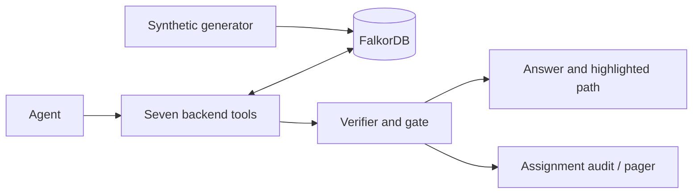

# Keystone SPEC

**Product:** evidence-backed incident triage, Tracks 1 and 3. Removing primary FalkorDB must break traversal, ownership verification, tracing and authorization.

| Tool | Inputs | Outputs |
| --- | --- | --- |
| blast_radius | service, time | unique dependents, minimum depths, evidence edges |
| criticality | affected services, time | PageRank, severity, escalation order |
| rank_owners | service, time | teams, supporting/conflicting claims, sources |
| trace_decision | service/topic, time | dated decisions, supersession/incident paths, spans |
| ownership_history | service, as_of (optional ISO timestamp) | READ-only ordered ownership/approval/dispute provenance, statuses, reasons and as-of rederivation; no ACT authorization |
| verify_path | edges, sources, tier, time | standing/status/access/citation checks, authority, confidence, receipt |
| propose_action | incident, receipt | ACT / ANSWER_ONLY / ESCALATE, assignment/paging result, audit ID |

**Anti-bypass:** parameterized queries; no agent Cypher/writes. ACL check precedes text/span retrieval. Backend derives status/identity from metadata and rechecks evidence before acting. Neither source text nor model output authorizes action.

**Model (builder-reported):** Person, Team, Service, Doc, Decision, Incident. Edges carry src_ids/src_conf/src_auth, spans, valid_from/status, and derived valid_to. Author metadata belongs to Doc.

**Oracle key:** `TYPE|src|dst|first_source_id`; expected_status is evaluation-only, never a derivation or agent input.

## Runtime queries and algorithms

Publish final executable templates in README:

- Resolve: `MATCH (p:Person) WHERE p.email=$email RETURN p`; repeat for `p.handle=$handle`. Name candidates: `MATCH (p:Person)-[m:MEMBER_OF]->(t:Team) WHERE t.id IN $teams RETURN p,m,t`.
- Claims/standing: `MATCH (a)-[e:OWNS|ON_CALL|MEMBER_OF|APPROVED|DISPUTES]->(b) WHERE b.id IN $ids RETURN a,e,b`.
- Blast radius: `MATCH (a:Service)-[e:DEPENDS_ON]->(b:Service) WHERE b.id IN $frontier RETURN a,e,b`; bounded frontier expansion plus visited set yields minimum depths.
- Trace: `MATCH (a)-[e:CONCERNS|SUPERSEDES|BECAUSE_OF|CAUSED_BY|DECIDED]->(b) WHERE a.id IN $frontier OR b.id IN $frontier RETURN a,e,b`; prevent revisits.
- ACL first: `MATCH (d:Doc) WHERE d.id IN $sources RETURN d.id,d.restricted`; deny without clearance before content queries. Authorized evidence only: `MATCH (d:Doc) WHERE d.id IN $sources RETURN d`; edges: `MATCH ()-[e]->() WHERE id(e) IN $edges RETURN e`. All graph evidence templates require the ACL check first.
- Derivation write: `MATCH ()-[e]->() WHERE id(e)=$id SET e.status=$status,e.valid_to=$end`.
- PageRank input: `MATCH (s:Service)-[e:DEPENDS_ON]->(t:Service) WHERE e.status='current' RETURN s,e,t`; apply time validity. Native `CALL algo.pageRank('Service','DEPENDS_ON')` **[CONFIRM IN DOCS]** requires an equivalent filtered projection; otherwise calculate PageRank from these FalkorDB rows. Never use an unfiltered-status shortcut.

**Outcome dependency:** elevate severity above a calibrated PageRank threshold **[TBD]**; escalate affected services in descending score order. P1 must distinguish hub from leaf at equal hop depth; removing PageRank must fail its expected severity/order check. Scores/timings: **[TBD]**.

**Evaluation graph:** headline results use the generator graph after deterministic derivation; extractor precision/recall are separate, and one live extraction is demo-only. Run 24 functional cases plus five separate blind attacks. One required ablation removes PageRank.

**Citations:** source ID belongs to an answer-path edge; span is verbatim in its text; access is permitted. Failure blocks the claim.

Latest builder-reported snapshot, not remeasured here: **6,247 nodes / 16,476 edges / 100 corpus docs / 220 curated edges**, all curated initially unverified. Procedure support and performance: **[TBD]**.
